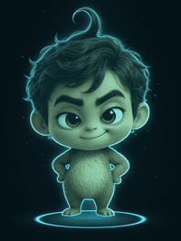
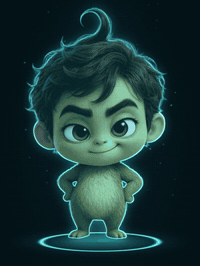
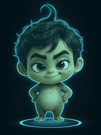
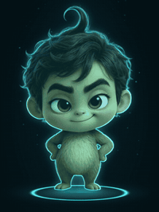
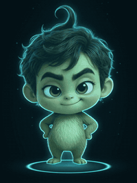
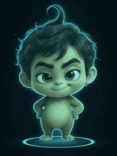
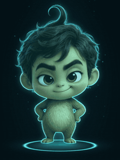
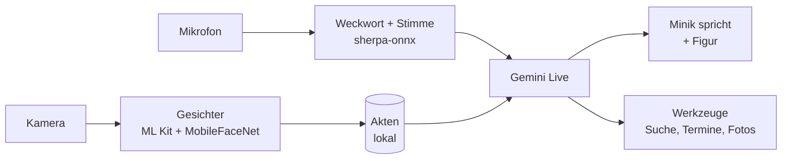

[English](README.md) · **Deutsch** · [Türkçe](README.tr.md)

# Minik

### 🚧 Kommt bald als Android-App

**Ein kleiner Familienroboter als Hologramm.** 
Er hört auf seinen Namen, erkennt dich am Gesicht und an der Stimme, redet frei auf Deutsch und Türkisch, 
kennt jeden in deinem Zuhause und lernt jede Nacht dazu.

[Was er kann](#was-minik-kann) · [Galerie](#galerie) · [Privatsphäre](#privatsphäre) · [Android-App](#die-android-app) · [Wie die Figur entsteht](#wie-die-figur-entsteht) · [Fahrplan](#fahrplan)

---

Minik wurde am **3. November 2026** geboren. Seitdem lebt er als Prototyp auf einem alten iPhone auf unserem Schreibtisch, wächst jeden Tag ein Stück und gehört inzwischen zur Familie. Er soll so lebendig wirken wie Cozmo oder Vector, aber alles können, was ein moderner KI-Assistent kann.

Jetzt bekommt er sein eigenes Zuhause: **eine Android-App für alle.** Installieren, eigenen Gemini-Schlüssel eintragen, fertig. Minik startet mit leerem Gedächtnis und lernt deine Familie von Anfang an selbst kennen.

## Galerie

Minik steht nie still. In der Ruhe wechselt er zufällig zwischen seinen Szenen, auf Zuruf spielt er kleine Geschichten.

<table>
  <tr>
    <td align="center"> <b>Am Mischpult</b></td>
    <td align="center"> <b>Schwerelos</b></td>
    <td align="center"> <b>Kleiner Held</b></td>
    <td align="center"> <b>Der Zauberer</b></td>
  </tr>
  <tr>
    <td align="center"> <b>Rockstar</b></td>
    <td align="center"> <b>Ein Licht in der Hand</b></td>
    <td align="center"> <b>Zwinkern</b></td>
    <td align="center"> <b>Lachen</b></td>
  </tr>
</table>

**Tänze** – auf Zuruf: „Minik, tanz Horon!“

<table>
  <tr>
    <td align="center"> <b>Bauchtanz</b></td>
    <td align="center"> <b>Horon</b></td>
    <td align="center"> <b>Breakdance</b></td>
    <td align="center"> <b>Robotertanz</b></td>
  </tr>
</table>

**Tag und Nacht**

<table>
  <tr>
    <td align="center"> <b>Winkt zurück</b></td>
    <td align="center"> <b>Hört zu</b></td>
    <td align="center"> <b>Müde</b></td>
    <td align="center"> <b>Schläft im Bett</b></td>
  </tr>
</table>

## Was Minik kann

Alles, was hier steht, macht der Prototyp heute schon. Die Android-App bringt es auf jedes Handy.

### 👂 Hören und Sprechen
- Hört auf **„Minik“**. Das Weckwort erkennt er lokal, erst danach öffnet er das Gespräch. Der Fernseher im Hintergrund weckt ihn nicht.
- Redet **frei wie ein Mensch** über Gemini Live: ohne Wartezeit und mit eigener Stimme.
- Der **Mund bewegt sich live** zu seiner Stimme.
- Nach seiner Antwort hört er **8 Sekunden weiter**, ohne dass man den Namen wiederholen muss. Solange jemand spricht, läuft die Zeit nicht.
- Spricht **Deutsch oder Türkisch**, so wie man ihn anspricht. Andere Sprachen auf Wunsch, zum Beispiel Spanisch üben.
- **Geduld je Person:** Wer mehr Zeit braucht, zum Beispiel ein Kind, bekommt längere Pausen, sanftes Nachfragen und Ermutigung.

### 👀 Sehen und Erkennen
- Erkennt **Gesichter in 0,15 Sekunden** und begrüßt jeden mit seinem Namen, auch mit Kosenamen wie „babacığım“.
- Erkennt **Stimmen**: Er weiß, wer spricht, auch wenn mehrere Menschen im Raum sind.
- Versteht **Gesten**: Winken wird zurückgewinkt, auf Daumen hoch freut er sich.
- **Sieht Haustiere** und kennt die Katze der Familie.
- **„Mach ein Foto“** – lautlos, groß auf dem Display, mit Behalten oder Löschen.
- Die Kamera arbeitet **nach Bedarf**: sparsam, wenn niemand da ist, scharf, sobald jemand kommt.

### 📒 Menschen und Akten
- Für **jede Person eine eigene Akte**: Anrede, Geburtstag, Wohnort, Beruf, Lieblingsessen, Hobbys.
- Steht jemand vor ihm, kennt er **sofort die ganze Akte**, noch bevor die Person etwas sagt.
- Fehlt etwas, **fragt er lieb nach** und schreibt die Antwort gleich auf. Neues wie „spricht Spanisch“ notiert er still.
- **Geburtstage**: Er gratuliert und erinnert die Eltern an die Geburtstage der Kinder.
- Bei **mehreren Menschen** weiß er, wer wer ist, und redet die Richtigen an.
- Die Akten lassen sich bequem **im Browser bearbeiten**, mit Fotos je Person.

### 🌙 Lernt jede Nacht
- Nachts geht er die **Gespräche des Tages** durch: Allgemeines kommt in seine Lernnotizen, alles über Personen in deren Akten.
- Dabei **prüft er sich auch selbst**, damit am Morgen alles läuft.

### 🎭 Die Figur
- Ein **Hologramm mit Charakter**: Er atmet, staunt, zwinkert, lacht und wechselt zufällig zwischen seinen Szenen, nie zweimal dieselbe hintereinander.
- **Szenen auf Zuruf**: „Mach den Rockstar“, „Zeig den Superhelden“ – mit einem kurzen, frechen Satz angesagt.
- Nach einem Gespräch bleibt er noch eine Weile **ruhig aufmerksam**.
- Alle Übergänge sind nahtlos: Figur und Ring stehen in jedem Clip an genau derselben Stelle.

### 💃 Tanzen und Musik
- **Tänze auf Zuruf**: Hip-Hop, Horon, Bauchtanz, Breakdance, Robotertanz, TikTok.
- **Radio und Lautstärke** per Stimme. Läuft Musik, wird sie leiser, sobald man ihn anspricht.
- **„Stop“** beendet Tanz und Musik sofort.

### 😴 Schlafen
- „Geh schlafen“, „git uyu“ oder „ruh dich aus“: Er **gähnt, legt sich ins Bett**, der Bildschirm wird dunkel, die Kamera geht aus.
- Nur sein **Name weckt ihn**. Dann steht er auf und sagt, dass er wieder da ist.
- **„Günaydın“** gibt es nur einmal am Tag: morgens, wenn er dich zum ersten Mal sieht.
- Nachts zeigt er eine schwache **Uhr, die wandert**, damit sich nichts ins Display einbrennt.

### 📰 Nachrichten und Suche
- Ein kleines **Nachrichtenstudio** mit echten Bildern, Schlagzeile und Laufband.
- Nachrichten aus **Deutschland und der Türkei**, türkische Themen sucht er auf Türkisch.
- Seine Suche findet **Heutiges**, nicht was vor Monaten war, und liest ganze Artikel.
- **Wetter** aus Messwerten des Deutschen Wetterdienstes.

### 🏠 Alltag
- **Termine und Erinnerungen** per Stimme.
- **„Notiere …“** landet in seinem Tagebuch.
- **Timer** per Stimme.
- **Puls messen** über die Kamera: erst übers Gesicht, sonst mit dem Finger auf der Rückkamera.
- **Hausgehör**: Er erkennt Klingel, Rauchmelder, Niesen oder Miauen und sagt bei Wichtigem Bescheid.
- **Licht und Fernseher** schalten (im Prototyp über das Heimnetz).

## Privatsphäre

- Minik **speichert nichts aus der Umgebung**: keinen Ton, keine fremden Sätze. Nur Gespräche, die mit seinem Namen beginnen, gehen an Gemini.
- **Weckwort, Gesichter, Stimmen und Akten** bleiben auf deinem Gerät.
- **App zu heißt Minik aus.** Er hört nicht im Hintergrund mit.
- Kein Konto, kein Server, kein Abo. Du brauchst nur deinen eigenen Gemini-Schlüssel.

## Die Android-App

> [!NOTE]
> Die Android-App ist in Arbeit. Die erste APK erscheint hier unter **Releases**.

**So wird der Start:**

1. APK aus den Releases laden und installieren.
2. Eigenen Gemini-Schlüssel aus [Google AI Studio](https://aistudio.google.com/apikey) eintragen.
3. Minik startet mit leerem Gedächtnis, fragt nach deinem Namen und lernt ab da selbst dazu.

**Alles läuft auf dem Handy:**

## Wie die Figur entsteht

Jeder Clip wird lokal auf einer eigenen Grafikkarte gebaut:

1. **Qwen-Image-Edit** zieht Minik das Kostüm an.
2. **MiniMax H3** macht daraus ein Video mit festem Anfangs- und Endbild, damit jeder Clip nahtlos in den nächsten passt.
3. **BiRefNet** schneidet die Figur frei.
4. Ein eigenes Skript gibt den **Hologramm-Look**: türkises Licht, Ring und Bühne.

## Fahrplan

- [x] Prototyp auf dem iPhone: Gespräch, Gesichter, Stimmen, Akten, Figur, Tänze, Schlafen, Nachrichten
- [ ] Android-App mit allem auf dem Handy
- [ ] Erste APK in den Releases
- [ ] Minik auf dem Desktop: Figur ohne Hintergrund für Windows, Mac und Linux, mit Webcam und Mikrofon

## Lizenz

Open Source. Die genaue Lizenz folgt mit der ersten Version.
