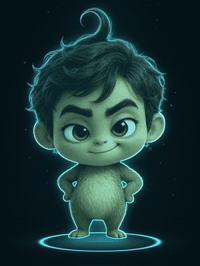
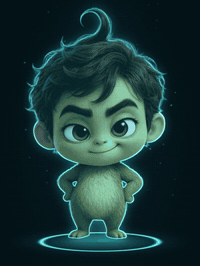
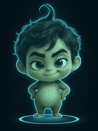
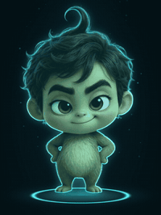
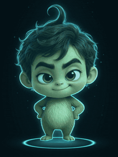
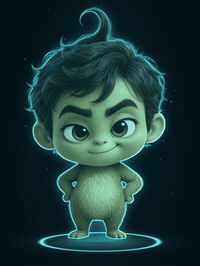
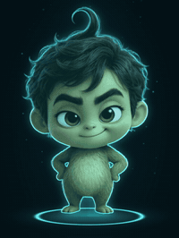
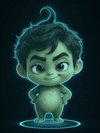
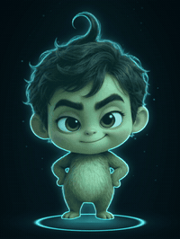
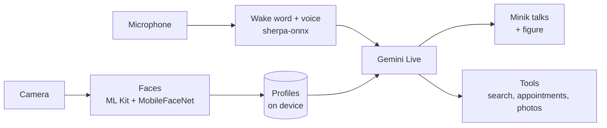

**English** · [Deutsch](README.de.md) · [Türkçe](README.tr.md)

# Minik

## *Everyone is building their own Jarvis. Skip it – meet Minik.*

### 🚧 Coming soon as an Android app

**Android first, then for your PC: Windows, Mac and Linux.**

**A little hologram who lives in your phone.** 
He wakes up to his name, knows you by your face and your voice, talks freely in your language – German, Turkish, English and many more – 
knows everyone in your home and learns something new every night.

[His brain](#his-brain) · [What he can do](#what-minik-can-do) · [Gallery](#gallery) · [Privacy](#privacy) · [Android app](#the-android-app) · [How the figure is made](#how-the-figure-is-made) · [Roadmap](#roadmap)

---

Minik was born on **November 3, 2026**. Since then he has lived as a prototype on an old iPhone on our desk, growing a little every day, and he has become part of the family. He is meant to feel as alive as Cozmo or Vector, while doing everything a modern AI assistant can do.

Now he gets a home of his own: **an Android app for everyone.** Install it, enter your own Gemini key, done. Minik starts with an empty memory and gets to know your family by himself, from day one.

## His brain

**A memory that grows with you.** Minik doesn't forget. His brain is a small archive that grows with every conversation – about your family, your friends and about himself.

- 📒 **A profile for everyone.** Family and friends each get their own profile: how he should address them, birthday, hometown, job, favorite food, hobbies, and everything he learns about them in conversation.
- 🧭 **A signpost instead of everything at once.** In his head there is just one short line per person saying who they are. When someone stands in front of him, he pulls up their whole profile before they say a word. Ask about someone who isn't there, and he reads exactly that profile. So he stays fast, even with a big family.
- ✍️ **He fills the gaps himself.** If something is missing, he asks kindly, only a few times a day, and writes the answer down right away. New things like “speaks Spanish” he notes quietly.
- 🌙 **He learns every night.** At night he rereads the day's conversations: anything important about a person goes into their profile, general things into his own learning notes. In the morning he knows more than the evening before, and he checks himself so everything works.
- 🗓️ **He keeps moments.** Appointments, reminders, notes in his diary, birthdays, photos for each person.
- 🔑 **You're in control.** You can read, change, add to or delete every profile. His memory lives on your device and belongs to you.

Over time Minik gets to know your family the way a good friend does: he knows whose birthday is this weekend, who is learning Spanish and who needs a little more patience when talking.

## Gallery

Minik never stands still. When nobody is talking to him, he switches between his scenes at random, and on request he acts out little stories.

<table>
  <tr>
    <td align="center"> <b>At the decks</b></td>
    <td align="center"> <b>Weightless</b></td>
    <td align="center"> <b>Little hero</b></td>
    <td align="center"> <b>The wizard</b></td>
  </tr>
  <tr>
    <td align="center"> <b>Rock star</b></td>
    <td align="center"> <b>A light in his hands</b></td>
    <td align="center"> <b>Wink</b></td>
    <td align="center"> <b>Laughing</b></td>
  </tr>
</table>

**Dances** – just ask: “Minik, dance the Horon!”

<table>
  <tr>
    <td align="center"> <b>Belly dance</b></td>
    <td align="center"> <b>Horon</b></td>
    <td align="center"> <b>Breakdance</b></td>
    <td align="center"> <b>Robot dance</b></td>
  </tr>
  <tr>
    <td align="center"> <b>Hip-hop</b></td>
    <td align="center"> <b>Hip-hop, round two</b></td>
  </tr>
</table>

**Day and night**

<table>
  <tr>
    <td align="center"> <b>Waves back</b></td>
    <td align="center"> <b>Listening</b></td>
    <td align="center"> <b>Sleepy</b></td>
    <td align="center"> <b>Asleep in bed</b></td>
  </tr>
</table>

## What Minik can do

Everything listed here already works in the prototype today. The Android app brings it to any phone.

### 👂 Listening and talking
- Wakes up to **“Minik”**. The wake word is detected on the device, and only then does he open a conversation. A TV in the background won't wake him.
- **Talks freely, like a person**, through Gemini Live: no waiting, with his own voice.
- His **mouth moves live** with his voice.
- After answering he **keeps listening for 8 seconds**, so you don't have to say his name again. While someone is talking, the timer pauses.
- Speaks **many languages** thanks to Gemini: German, Turkish, English, Spanish, French, Arabic and many more. He answers in the language you speak to him, and he can help you practice a new one.
- **Patience per person:** someone who needs more time, like a child, gets longer pauses, gentle follow-up questions and encouragement.

### 👀 Seeing and recognizing
- Recognizes **faces in 0.15 seconds** and greets everyone by name, nicknames included.
- Recognizes **voices**: he knows who is speaking, even with several people in the room.
- Understands **gestures**: he waves back, and a thumbs-up makes him happy.
- **Sees pets** and knows the family cat.
- **“Take a photo”** – silently, shown large on the screen, with Keep or Delete.
- The camera works **on demand**: frugal when nobody is around, sharp as soon as someone shows up.

### 🎭 The figure
- **A hologram with character**: he breathes, marvels, winks, laughs and switches between his scenes at random, never the same one twice in a row.
- **Scenes on request**: “Do the rock star”, “Show me the superhero” – announced with a short, cheeky line.
- After a conversation he stays **calm and attentive** for a while.
- Every transition is seamless: the figure and the ring sit in exactly the same spot in every clip.

### 💃 Dancing and music
- **Dances on request**: hip-hop, Horon, belly dance, breakdance, robot dance, TikTok.
- **Radio and volume** by voice. When music is playing, it gets quieter as soon as you talk to him.
- **“Stop”** ends dance and music immediately.

### 😴 Sleeping
- “Go to sleep”, “git uyu” or “have a rest”: he **yawns and gets into bed**, the screen goes dark, the camera turns off.
- Only **his name wakes him**. Then he gets up and says he's back.
- **“Günaydın”** (good morning) only once a day: in the morning, the first time he sees you.
- At night he shows a faint **clock that drifts** across the screen so nothing burns in.

### 📰 News and search
- A little **news studio** with real pictures, headline and ticker.
- News from **Germany and Turkey**; Turkish topics he searches in Turkish.
- His search finds **today's news**, not what happened months ago, and reads full articles.
- **Weather** from measurements of the German Weather Service (DWD).

### 🏠 Everyday life
- **Appointments and reminders** by voice.
- **“Make a note …”** goes into his diary.
- **Timers** by voice.
- **Measures your pulse** with the camera: first from your face, otherwise with a finger on the rear camera.
- **Home hearing**: he recognizes doorbells, smoke alarms, sneezing or meowing and speaks up when it matters.
- Switches **lights and the TV** (in the prototype via the home network).

## Privacy

- Minik **stores nothing from his surroundings**: no audio, no overheard sentences. Only conversations that start with his name go to Gemini.
- **Wake word, faces, voices and profiles** stay on your device.
- **App closed means Minik is off.** He does not listen in the background.
- No account, no server, no subscription. All you need is your own Gemini key.

## The Android app

> [!NOTE]
> The Android app is in progress. The first APK will appear here under **Releases**.

**Getting started will look like this:**

1. Download the APK from Releases and install it.
2. Enter your own Gemini key from [Google AI Studio](https://aistudio.google.com/apikey).
3. Minik starts with an empty memory, asks for your name and learns on his own from there.

**Minik's control center in the app.** Just like the board of the prototype, you see and steer everything yourself and make Minik your own:

- 🏠 **Today:** what he's up to right now, plus the day's appointments and events.
- 📒 **People & profiles:** read and edit every profile, add new people, assign photos.
- 💬 **Conversations:** what was said, with transcript and who said it.
- 🗓️ **Calendar & notes:** appointments, reminders and his diary.
- 🧠 **Brain:** see what he has learned, correct it, or tell him to forget something.
- 🎬 **Clips:** watch all his scenes and dances and rate them.
- ⚙️ **Settings:** language, wake word, patience per person, camera and microphone, which scenes and dances he shows, and much more.

**Everything runs on the phone:**

## Coming next

### 🖥️ Minik on your PC
After the Android app, Minik moves onto your computer: a little figure **without background**, standing right on your desktop. He sees you through the webcam, hears you through the microphone and talks to you, just like on the phone. For **Windows, Mac and Linux**.

### 🎄 Christmas update
For Christmas, Minik gets a big update with **new videos and new interactions**.

## How the figure is made

Every clip is built locally on our own graphics card:

1. **Qwen-Image-Edit** puts Minik into his costume.
2. **MiniMax H3** turns it into a video with a fixed first and last frame, so every clip flows seamlessly into the next.
3. **BiRefNet** cuts the figure out.
4. A custom script adds the **hologram look**: turquoise light, ring and stage.

## Roadmap

- [x] iPhone prototype: conversation, faces, voices, profiles, figure, dances, sleeping, news
- [ ] Android app with everything on the phone
- [ ] First APK in Releases
- [ ] 🎄 Christmas update with new videos and interactions
- [ ] Minik on the desktop: a figure without background for Windows, Mac and Linux, with webcam and microphone

## License

Open source. The exact license will follow with the first release.
