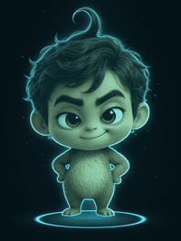
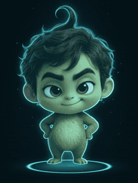
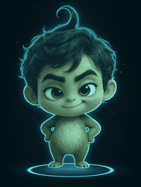
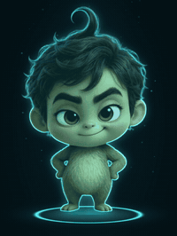
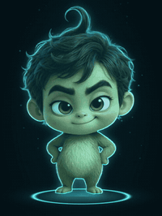
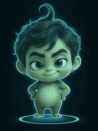
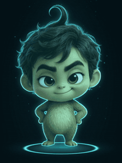
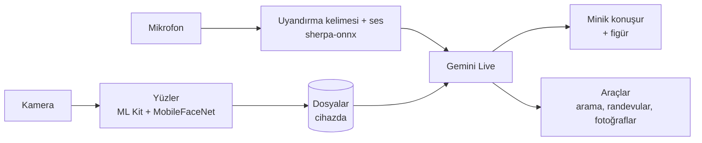

[English](README.md) · [Deutsch](README.de.md) · **Türkçe**

# Minik

### 🚧 Yakında Android uygulaması olarak

**Hologram olarak yaşayan küçük bir aile robotu.** 
Adını duyunca uyanır, seni yüzünden ve sesinden tanır, Almanca ve Türkçe rahatça konuşur, 
evindeki herkesi tanır ve her gece yeni bir şey öğrenir.

[Neler yapabilir](#minik-neler-yapabilir) · [Galeri](#galeri) · [Gizlilik](#gizlilik) · [Android uygulaması](#android-uygulaması) · [Figür nasıl yapılıyor](#figür-nasıl-yapılıyor) · [Yol haritası](#yol-haritası)

---

Minik **3 Kasım 2026**'da doğdu. O günden beri masamızdaki eski bir iPhone'da prototip olarak yaşıyor, her gün biraz daha büyüyor ve artık ailenin bir parçası. Cozmo ya da Vector kadar canlı hissettirmesi, ama modern bir yapay zekâ asistanının yapabildiği her şeyi yapabilmesi amaçlanıyor.

Şimdi kendi evine kavuşuyor: **herkes için bir Android uygulaması.** Yükle, kendi Gemini anahtarını gir, hepsi bu. Minik boş bir hafızayla başlar ve aileni ilk günden itibaren kendi kendine tanır.

## Galeri

Minik hiç durmaz. Kimse onunla konuşmadığında sahneleri arasında rastgele geçiş yapar, istenince küçük hikâyeler canlandırır.

<table>
  <tr>
    <td align="center"> <b>DJ masasında</b></td>
    <td align="center"> <b>Yerçekimsiz</b></td>
    <td align="center"> <b>Küçük kahraman</b></td>
    <td align="center"> <b>Sihirbaz</b></td>
  </tr>
  <tr>
    <td align="center"> <b>Rock yıldızı</b></td>
    <td align="center"> <b>Avucunda bir ışık</b></td>
    <td align="center"> <b>Göz kırpıyor</b></td>
    <td align="center"> <b>Gülüyor</b></td>
  </tr>
</table>

**Danslar** – söylemen yeter: „Minik, horon oyna!“

<table>
  <tr>
    <td align="center"> <b>Göbek dansı</b></td>
    <td align="center"> <b>Horon</b></td>
    <td align="center"> <b>Breakdance</b></td>
    <td align="center"> <b>Robot dansı</b></td>
  </tr>
</table>

**Gece ve gündüz**

<table>
  <tr>
    <td align="center"> <b>El sallıyor</b></td>
    <td align="center"> <b>Dinliyor</b></td>
    <td align="center"> <b>Uykusu geldi</b></td>
    <td align="center"> <b>Yatağında uyuyor</b></td>
  </tr>
</table>

## Minik neler yapabilir

Burada yazan her şey prototipte bugün zaten çalışıyor. Android uygulaması bunları her telefona getiriyor.

### 👂 Dinlemek ve konuşmak
- **„Minik“** deyince uyanır. Uyandırma kelimesini cihazın üzerinde algılar, sohbeti ancak ondan sonra açar. Arkada açık kalan televizyon onu uyandırmaz.
- Gemini Live ile **bir insan gibi rahatça konuşur**: beklemeden, kendi sesiyle.
- Konuşurken **ağzı sesine göre canlı hareket eder**.
- Cevabından sonra **8 saniye daha dinler**, adını tekrar söylemene gerek kalmaz. Biri konuşurken süre işlemez.
- Ona nasıl hitap edersen öyle, **Almanca ya da Türkçe** konuşur. İstenirse başka dillerde de, örneğin İspanyolca pratik yapmak için.
- **Kişiye göre sabır:** Daha çok zamana ihtiyacı olan, örneğin bir çocuk, daha uzun aralar, nazik sorular ve cesaret alır.

### 👀 Görmek ve tanımak
- **Yüzleri 0,15 saniyede tanır** ve herkesi adıyla, hatta „babacığım“ gibi sevgi sözcükleriyle selamlar.
- **Sesleri tanır**: Odada birkaç kişi olsa bile kimin konuştuğunu bilir.
- **Hareketleri anlar**: El sallayana el sallar, başparmak yukarı görünce sevinir.
- **Evcil hayvanları görür** ve ailenin kedisini tanır.
- **„Fotoğraf çek“** – sessizce, ekranda büyük, Sakla ya da Sil seçeneğiyle.
- Kamera **ihtiyaca göre** çalışır: kimse yokken tasarruflu, biri gelince net.

### 📒 İnsanlar ve dosyalar
- **Herkes için ayrı bir dosya**: hitap şekli, doğum günü, memleket, meslek, sevdiği yemek, hobiler.
- Biri karşısına geçtiğinde, daha o kişi konuşmadan **dosyasının tamamını bilir**.
- Bir şey eksikse **tatlılıkla sorar** ve cevabı hemen not eder. „İspanyolca biliyor“ gibi yenilikleri sessizce kaydeder.
- **Doğum günleri**: Kutlar ve anne babaya çocuklarının doğum günlerini hatırlatır.
- **Birden fazla kişi** varken kimin kim olduğunu bilir ve doğru kişiye hitap eder.
- Dosyalar fotoğraflarıyla birlikte **tarayıcıdan kolayca düzenlenir**.

### 🌙 Her gece öğrenir
- Geceleri **günün sohbetlerini** gözden geçirir: Genel bilgiler öğrenme notlarına, bir kişiyle ilgili her şey o kişinin dosyasına gider.
- Sabah her şey yolunda olsun diye **kendini de kontrol eder**.

### 🎭 Figür
- **Karakteri olan bir hologram**: Nefes alır, hayret eder, göz kırpar, güler ve sahneleri arasında rastgele geçer, aynı sahne asla art arda gelmez.
- **İstek üzerine sahneler**: „Rock yıldızını yap“, „Süper kahramanı göster“ – kısa ve şakacı bir cümleyle duyurur.
- Bir sohbetten sonra bir süre **sakin ve dikkatli** kalır.
- Tüm geçişler kesintisizdir: Figür ve halka her klipte tam aynı yerde durur.

### 💃 Dans ve müzik
- **İstek üzerine danslar**: hip-hop, horon, göbek dansı, breakdance, robot dansı, TikTok.
- **Radyo ve ses seviyesi** sesle kontrol edilir. Müzik çalarken ona seslendiğin anda müzik kısılır.
- **„Dur“** dansı ve müziği hemen bitirir.

### 😴 Uyku
- „Git uyu“, „git dinlen“ ya da „geh schlafen“: **Esner, yatağına yatar**, ekran kararır, kamera kapanır.
- Onu sadece **adı uyandırır**. Kalkar ve geri döndüğünü söyler.
- **„Günaydın“** günde sadece bir kez: sabah seni ilk gördüğünde.
- Geceleri ekranda iz kalmasın diye **yavaşça yer değiştiren** soluk bir saat gösterir.

### 📰 Haberler ve arama
- Gerçek görüntüler, manşet ve kayan yazıyla küçük bir **haber stüdyosu**.
- **Almanya ve Türkiye**'den haberler; Türkçe konuları Türkçe arar.
- Araması aylar öncesini değil **bugünü** bulur ve makalelerin tamamını okur.
- **Hava durumu** Alman Meteoroloji Servisi'nin (DWD) ölçümlerinden.

### 🏠 Günlük hayat
- Sesle **randevular ve hatırlatmalar**.
- **„Not al …“** dediğin şey günlüğüne yazılır.
- Sesle **zamanlayıcı**.
- Kamerayla **nabız ölçer**: önce yüzünden, olmazsa arka kameraya koyduğun parmağından.
- **Ev kulağı**: Kapı zilini, duman alarmını, hapşırmayı ya da miyavlamayı tanır, önemli olduğunda haber verir.
- **Işıkları ve televizyonu** açıp kapatır (prototipte ev ağı üzerinden).

## Gizlilik

- Minik **çevresinden hiçbir şey kaydetmez**: ne ses ne de duyduğu yabancı cümleler. Gemini'ye sadece adıyla başlayan sohbetler gider.
- **Uyandırma kelimesi, yüzler, sesler ve dosyalar** cihazında kalır.
- **Uygulama kapalıysa Minik de kapalıdır.** Arka planda dinlemez.
- Hesap yok, sunucu yok, abonelik yok. Tek ihtiyacın kendi Gemini anahtarın.

## Android uygulaması

> [!NOTE]
> Android uygulaması yapım aşamasında. İlk APK burada **Releases** altında yayınlanacak.

**Başlangıç şöyle olacak:**

1. APK'yı Releases'ten indir ve yükle.
2. [Google AI Studio](https://aistudio.google.com/apikey)'dan aldığın kendi Gemini anahtarını gir.
3. Minik boş bir hafızayla başlar, adını sorar ve oradan sonra kendi kendine öğrenir.

**Her şey telefonda çalışır:**

## Figür nasıl yapılıyor

Her klip kendi ekran kartımızda yerel olarak üretiliyor:

1. **Qwen-Image-Edit** Minik'e kostümünü giydirir.
2. **MiniMax H3** bunu sabit ilk ve son kareli bir videoya dönüştürür, böylece her klip bir sonrakine kesintisiz bağlanır.
3. **BiRefNet** figürü arka plandan ayırır.
4. Kendi yazdığımız bir betik **hologram görünümünü** verir: turkuaz ışık, halka ve sahne.

## Yol haritası

- [x] iPhone prototipi: sohbet, yüzler, sesler, dosyalar, figür, danslar, uyku, haberler
- [ ] Her şeyi telefonda çalıştıran Android uygulaması
- [ ] Releases altında ilk APK
- [ ] Masaüstünde Minik: Windows, Mac ve Linux için arka plansız figür, web kamerası ve mikrofonla

## Lisans

Açık kaynak. Kesin lisans ilk sürümle birlikte belirlenecek.
